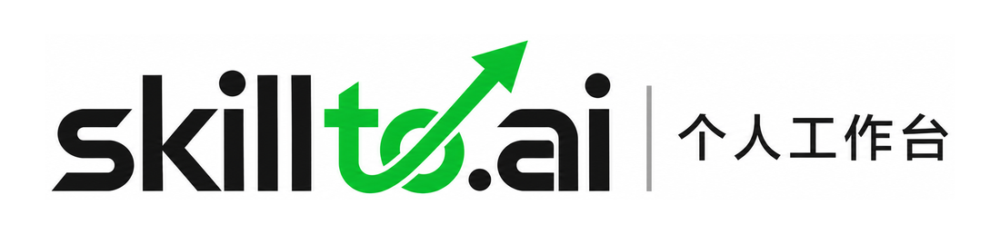
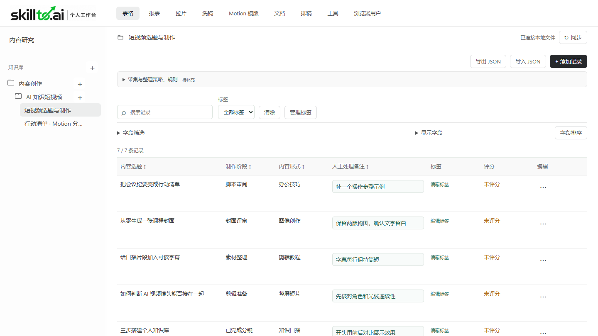
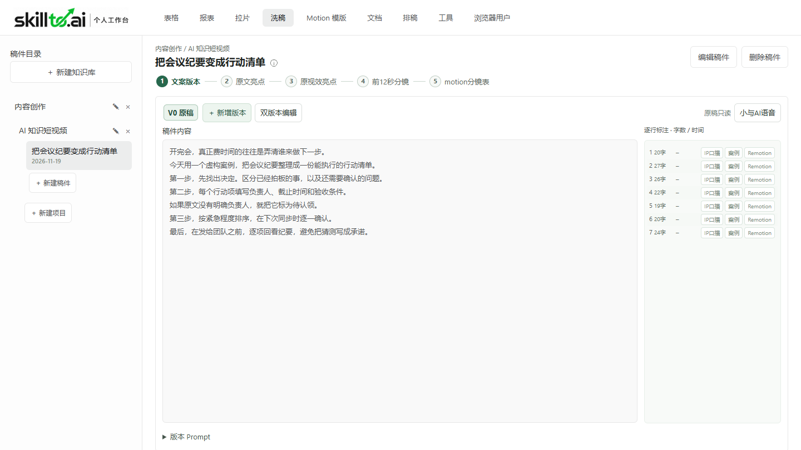
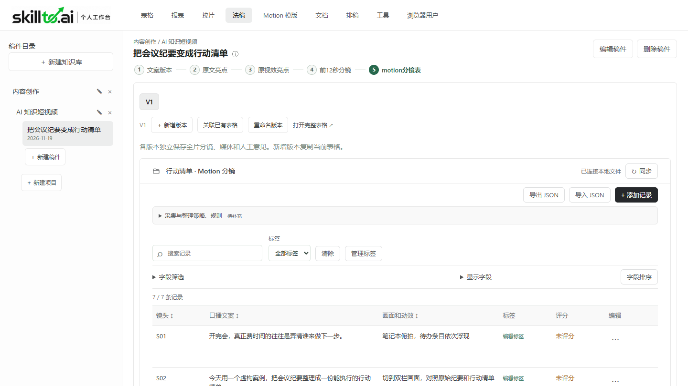

<p align="center">
  <picture>
    <source media="(prefers-color-scheme: dark)" srcset="docs/readme/assets/studio-logo-dark.png">
    
  </picture>
</p>

<h1 align="center">Skillto.ai Studio</h1>

<p align="center">Ein persönlicher KI-Arbeitsplatz für Content-Produktion und den Arbeitsalltag</p>

<p align="center"><a href="#funktionen">Funktionen</a> · <a href="#screenshots">Screenshots</a> · <a href="#schnellstart">Schnellstart</a> · <a href="skills/skillto-ai-studio/references/installation.md">Dokumentation</a><br>
  <a href="https://github.com/skilltoAI/skillto-ai-studio">GitHub</a> ·
  <a href="https://codeup.aliyun.com/6856a1da33ca8867a4350914/skillto-ai-studio">Codeup</a> ·
  <a href="skills/skillto-ai-studio/SKILL.md"><kbd>19 Skills</kbd></a> ·
  <a href="apps/stass/README.md"><kbd>STASS MCP</kbd></a>
</p>

<p align="center"><a href="README.md"><kbd>简体中文</kbd></a> &nbsp; <a href="README.en.md"><kbd>English</kbd></a> &nbsp; <a href="README.ja.md"><kbd>日本語</kbd></a> &nbsp; <kbd>Deutsch</kbd></p>

## Für wen ist das Projekt gedacht?

- **KI-Dozierende und Anbieter kostenpflichtiger Inhalte** können Themen recherchieren, Referenzvideos analysieren, Kursskripte schreiben und Cover sowie Storyboards prüfen.
- **KI-Anwender im Büroalltag** können Materialien, Dokumente und Aufgaben in Wissenssammlungen, Tabellen und Berichten organisieren und Anmerkungen festhalten.
- **KI-Kreative** können Figuren, Bildreferenzen, Einstellungen und Motion-Vorlagen verwalten sowie Bildgenerierung, Videogenerierung und Schnitt koordinieren.

## Funktionen

- **Skills.** Ein zentraler Skill leitet Aufgaben an 18 spezialisierte Skills weiter. Sie unterstützen Recherche, Medienanalyse, Storyboards, Cover, Berichte und Produktion.
- **Zusammenarbeit mit Agenten.** Über STASS MCP können Agenten wie Codex oder Claude Code in einem unterstützten Client Einträge lesen und aktualisieren. Menschen prüfen dieselben Daten im Browser.
- **KI-gestützter Schnitt.** Referenzclips analysieren, Ausschnitte auswählen und Notizen erfassen. Aus Rohschnitt und Untertiteln lässt sich der Schnitt von Talking-Head-Videos mit HyperFrames oder Remotion planen. Motion verwaltet Vorlagen.
- **Bild- und Videogenerierung.** Cover-Prompts, Figurenreferenzen und Einstellungen vorbereiten. Mit Creator MCP lassen sich visuelle Workflows zusammenstellen, Medien zuordnen und autorisierte Aufträge bei verfügbaren Diensten ausführen.

[Skill-Verzeichnis](README.md#技能清单) · [Kompatibilität und Abhängigkeiten](skills/skillto-ai-studio/references/compatibility.md)

## Screenshots

Aufnahmen aus einer laufenden STASS-Instanz mit fiktiven Beispieldaten.

**Redaktionsplanung mit Prüfanmerkungen**



**Skriptversionen und zeilenweise Anmerkungen**



**Verknüpftes Motion-Storyboard im Skriptbereich**



## Schnellstart

Benötigt werden Git, Python ab Version 3.10 und der gewünschte Client. Die folgenden Befehle zeigen die vorgesehenen Änderungen an und installieren die Skills:

```sh
git clone https://github.com/skilltoAI/skillto-ai-studio.git
cd skillto-ai-studio
python scripts/install.py --agent codex --dry-run
python scripts/install.py --agent codex
```

Für Claude Code ersetzt du `--agent codex` durch `--agent claude`. In einer neuen Sitzung startest du den Skill mit `$skillto-ai-studio` in Codex oder `/skillto-ai-studio` in Claude Code.

Die Befehle installieren die Skills. Die Windows-Anwendung, die MCP-Registrierung und externe Generierungsdienste werden separat eingerichtet. Das Windows-Offline-Paket ist ein Kandidat zur Erprobung. Die vollständige Prüfung von Installation und Upgrades auf anderen Windows-Rechnern steht noch aus.

[Windows-Installation und Status](README.md#windows-完整安装状态) · [Installation, Updates und Fehlerbehebung](skills/skillto-ai-studio/references/installation.md) · [Mitwirken](CONTRIBUTING.md)
