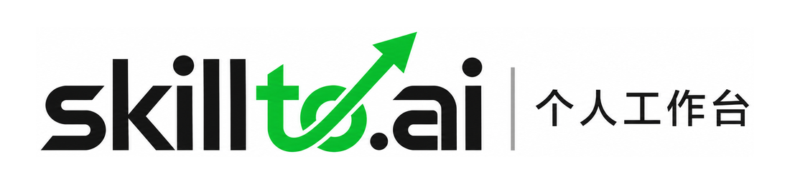
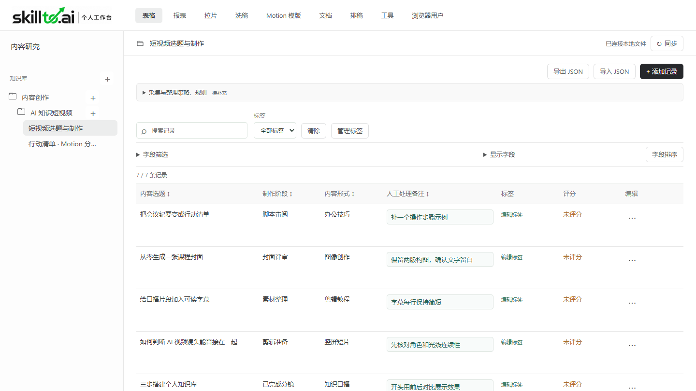
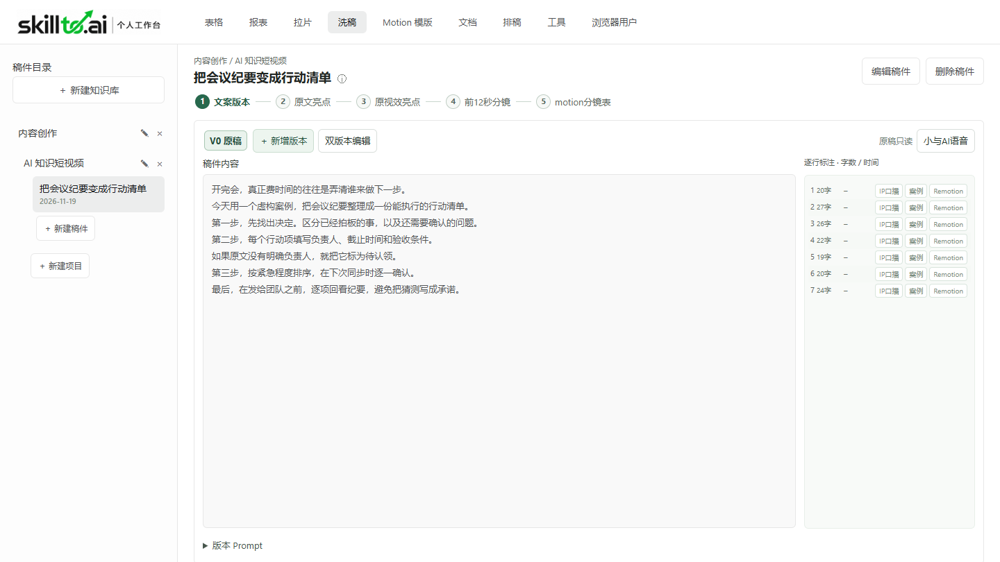
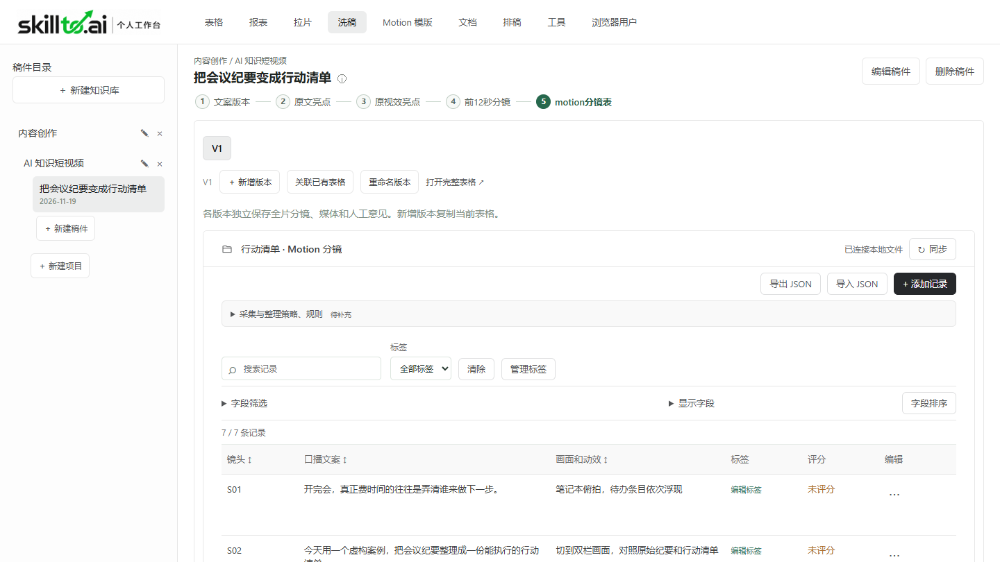

<p align="center">
  <picture>
    <source media="(prefers-color-scheme: dark)" srcset="docs/readme/assets/studio-logo-dark.png">
    
  </picture>
</p>

<h1 align="center">Skillto.ai Studio</h1>

<p align="center">The AI-native personal workspace built for agents</p>

<p align="center"><a href="#overview">Overview</a> · <a href="#features">Features</a> · <a href="#screenshots">Screenshots</a> · <a href="#quick-start">Quick start</a> · <a href="skills/skillto-ai-studio/references/installation.md">Documentation</a><br>
  <a href="https://www.skillto.ai/">Skillto.ai</a> ·
  <a href="https://github.com/skilltoAI/skillto-ai-studio">GitHub</a> ·
  <a href="https://codeup.aliyun.com/6856a1da33ca8867a4350914/skillto-ai-studio">Codeup</a> ·
  <a href="skills/skillto-ai-studio/SKILL.md"><kbd>19 Skills</kbd></a> ·
  <a href="apps/stass/README.md"><kbd>STASS MCP</kbd></a>
</p>

<p align="center"><a href="README.md"><kbd>简体中文</kbd></a> &nbsp; <kbd>English</kbd> &nbsp; <a href="README.ja.md"><kbd>日本語</kbd></a> &nbsp; <a href="README.de.md"><kbd>Deutsch</kbd></a></p>

## Overview

**Skillto.ai Studio is an AI-native personal workspace.** Describe what you want to achieve, and your agent selects the right Skills, works with your records through MCP, and leaves results you can review in knowledge bases, tables, scripts and storyboards. You can step in to edit the work, review it or decide what happens next.

Studio connects to the official Skillto.ai ecosystem. Bring available **AI assets, AI APIs and Skills** from the website into your workflow once the relevant services are connected and authorised. Keep the materials, decisions and deliverables for research, generation, editing and review together in one project. [Visit Skillto.ai](https://www.skillto.ai/)

## Who it is for

- **AI educators and paid-content creators** can research topics, break down reference videos, write teaching scripts, and review covers and storyboards.
- **Everyday AI users** can organise research, documents and tasks in knowledge bases, tables and reports, with space for human review notes.
- **AI creators** can manage characters, visual references, shots and motion templates while coordinating image generation, video generation and editing.

## Features

- **Skill orchestration.** One parent Skill routes tasks to 18 specialised Skills for research, media analysis, everyday work, storyboards, covers and reports.
- **A shared workspace for agents and people.** Supported agents read and update workspace records through STASS MCP. People can review and edit the same records in the browser.
- **AI-assisted editing and motion graphics.** Analyse reference clips, select segments and plan talking-head edits from rough cuts and subtitles with HyperFrames or Remotion. Organise templates and previews in Motion.
- **AI image and video generation.** Turn cover concepts, character references and shot plans into visual workflows. Creator MCP can bind assets, validate workflows, run authorised generation jobs and retrieve results. Available APIs, models and Skills depend on the website's offerings and your account permissions.

[Skill catalogue](README.md#技能清单) · [Host compatibility and dependencies](skills/skillto-ai-studio/references/compatibility.md)

## Screenshots

Captured from a running STASS instance with fictional demo data.

**Content planning table and review notes**



**Script versions and line annotations**



**Linked Motion storyboard in the script workspace**



## Quick start

Install Git, Python 3.10+ and your target client. Run these commands to preview and install the skills:

```sh
git clone https://github.com/skilltoAI/skillto-ai-studio.git
cd skillto-ai-studio
python scripts/install.py --agent codex --dry-run
python scripts/install.py --agent codex
```

For Claude Code, use `--agent claude` in place of `--agent codex`. Restart the session and invoke `$skillto-ai-studio` in Codex or `/skillto-ai-studio` in Claude Code.

The commands install the skills. The standalone Windows workstation, MCP registration and external generation services have separate setup steps. The Windows offline package is a candidate build. Full installation and upgrade validation on other Windows machines remains open.

[Windows installation and current status](README.md#windows-完整安装状态) · [Installation, upgrades and troubleshooting](skills/skillto-ai-studio/references/installation.md) · [Contributing](CONTRIBUTING.md)
