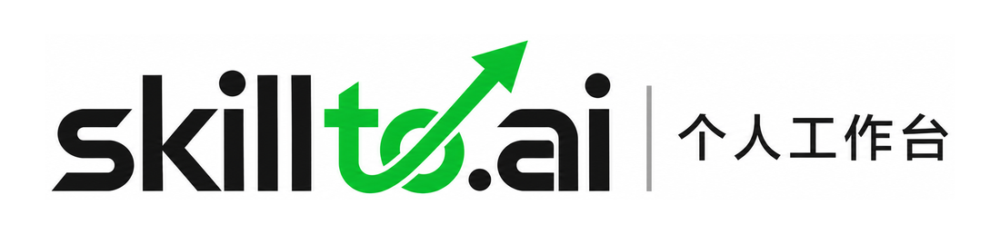
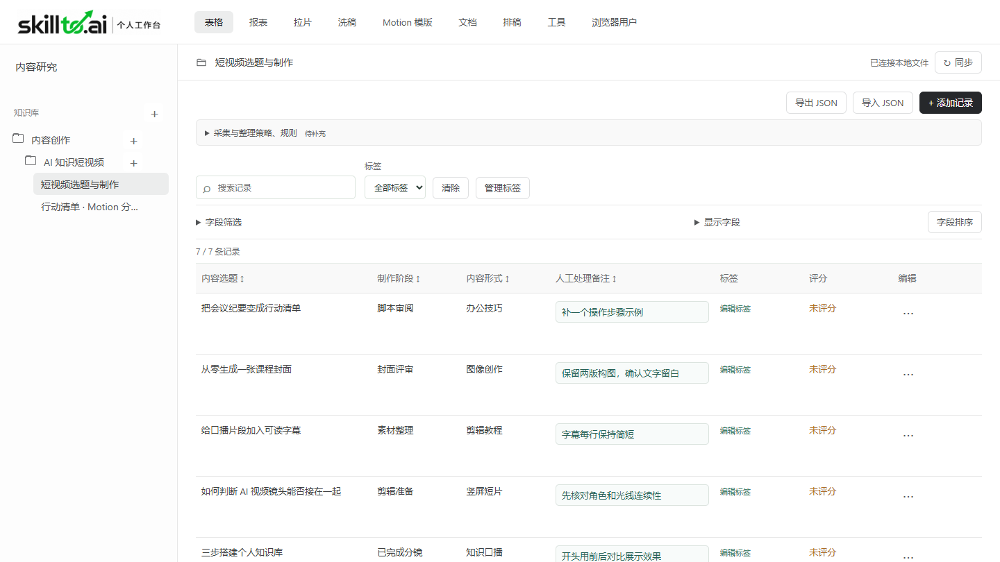
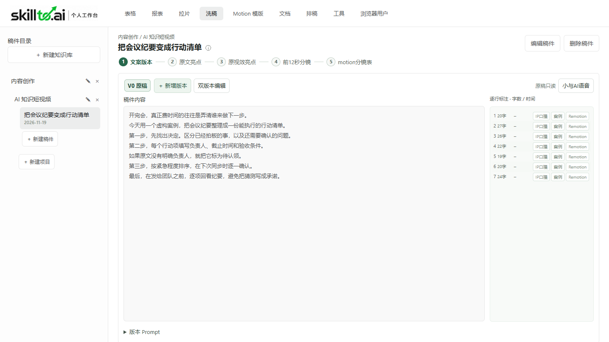
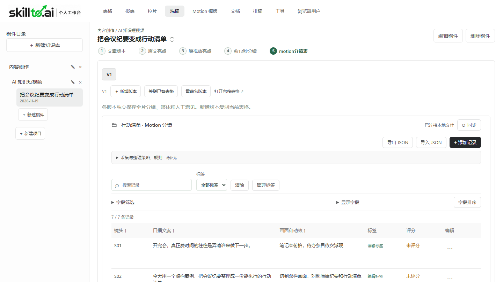

<p align="center">
  <picture>
    <source media="(prefers-color-scheme: dark)" srcset="docs/readme/assets/studio-logo-dark.png">
    
  </picture>
</p>

<h1 align="center">Skillto.ai Studio</h1>

<p align="center">エージェントのための AI ネイティブ・パーソナルワークスペース</p>

<p align="center"><a href="#概要">概要</a> · <a href="#主な機能">機能</a> · <a href="#スクリーンショット">画面</a> · <a href="#クイックスタート">インストール</a> · <a href="skills/skillto-ai-studio/references/installation.md">ドキュメント</a><br>
  <a href="https://www.skillto.ai/">Skillto.ai</a> ·
  <a href="https://github.com/skilltoAI/skillto-ai-studio">GitHub</a> ·
  <a href="https://codeup.aliyun.com/6856a1da33ca8867a4350914/skillto-ai-studio">Codeup</a> ·
  <a href="skills/skillto-ai-studio/SKILL.md"><kbd>19 Skills</kbd></a> ·
  <a href="apps/stass/README.md"><kbd>STASS MCP</kbd></a>
</p>

<p align="center"><a href="README.md"><kbd>简体中文</kbd></a> &nbsp; <a href="README.en.md"><kbd>English</kbd></a> &nbsp; <kbd>日本語</kbd> &nbsp; <a href="README.de.md"><kbd>Deutsch</kbd></a></p>

## 概要

**Skillto.ai Studio は、AI ネイティブなパーソナルワークスペースです。** やりたいことを自然な言葉で伝えると、エージェントが Skill を選び、MCP を通じて作業を進めます。成果はナレッジベース、表、台本、絵コンテに残り、いつでも人が確認・編集できます。

Skillto.ai の公式サービスと連携します。公式サイトで利用可能な **AI アセット、AI API、Skill** を取得し、サービスの接続と権限設定を済ませると、制作フローに組み込めます。企画調査から生成、編集、レビューまで、素材と成果物を一つのプロジェクトで管理できます。 [Skillto.ai 公式サイト](https://www.skillto.ai/)

## 対象ユーザー

- **AI 講座・有料コンテンツの制作者**は、テーマ選定、参考動画の分析、講座台本の執筆、表紙と絵コンテのレビューに活用できます。
- **日常業務で AI を使う人**は、資料・文書・タスクをナレッジベースや表、レポートに整理し、確認事項を記録できます。
- **AI クリエイター**は、キャラクター、参考素材、ショット、モーションテンプレートを管理し、画像生成、動画生成、編集の工程を連携できます。

## 主な機能

- **Skill によるタスクの振り分け**。親 Skill が目的に応じて 18 個の専門 Skill を選び、調査、メディア分析、日常業務、絵コンテ、表紙、レポートを支援します。
- **人とエージェントが共有するワークスペース**。対応するエージェントは STASS MCP で記録を読み取り、更新できます。人は同じ記録をブラウザーで確認・編集できます。
- **AI を使った動画編集とモーション**。参考動画を分析して区間を選び、仮編集や字幕から HyperFrames または Remotion での編集を計画します。Motion ではテンプレートとプレビューを管理できます。
- **AI 画像・動画生成**。表紙、キャラクター、ショット案をビジュアルワークフローにまとめます。Creator MCP で素材の割り当て、検証、承認済み生成ジョブの実行、結果の取得ができます。利用できる API、モデル、Skill は公式サイトの提供範囲とアカウント権限に応じます。

[スキル一覧](README.md#技能清单) · [対応クライアントと依存関係](skills/skillto-ai-studio/references/compatibility.md)

## スクリーンショット

稼働中の STASS を、架空のデモデータで撮影しました。

**企画管理表とレビュー用メモ**



**台本のバージョン管理と行ごとの注釈**



**台本から参照できる Motion 絵コンテ**



## クイックスタート

Git、Python 3.10 以降、利用するクライアントを用意し、次のコマンドでスキルを確認・インストールします。

```sh
git clone https://github.com/skilltoAI/skillto-ai-studio.git
cd skillto-ai-studio
python scripts/install.py --agent codex --dry-run
python scripts/install.py --agent codex
```

Claude Code の場合は `--agent codex` を `--agent claude` に置き換えます。新しいセッションで、Codex では `$skillto-ai-studio`、Claude Code では `/skillto-ai-studio` を呼び出します。

この手順でインストールされるのはスキルです。Windows 用ワークステーション、MCP の登録、外部の生成サービスは個別に設定します。オフラインパッケージは候補版で、別の Windows 環境での完全なインストールと更新の検証は継続中です。

[Windows の導入状況](README.md#windows-完整安装状态) · [導入・更新・トラブルシューティング](skills/skillto-ai-studio/references/installation.md) · [開発への参加](CONTRIBUTING.md)
