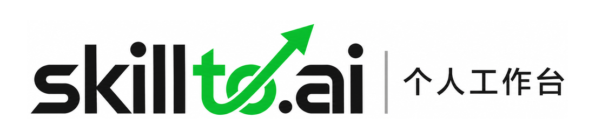
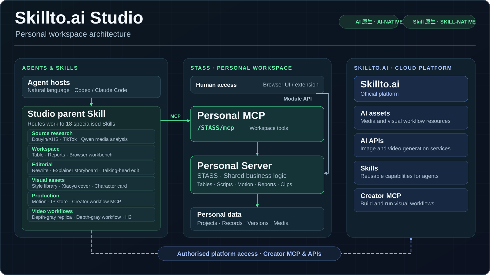
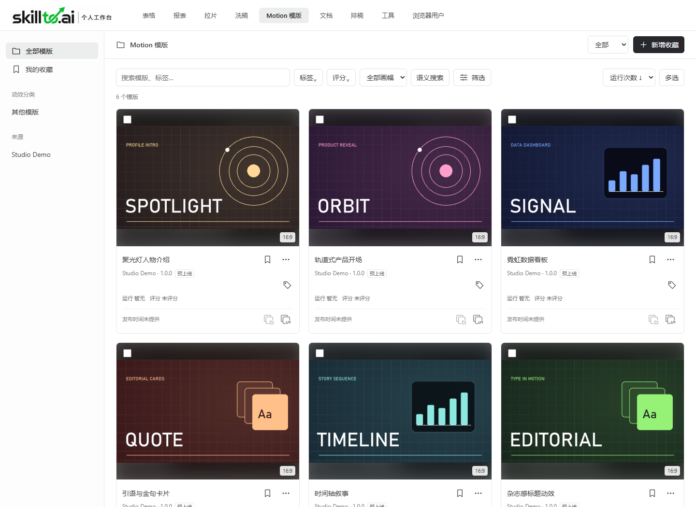
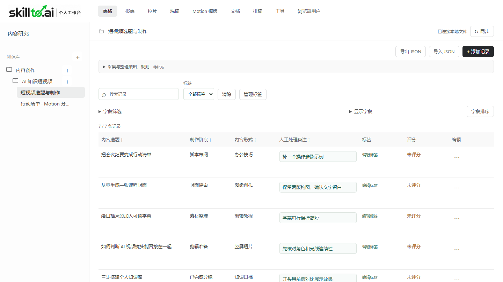
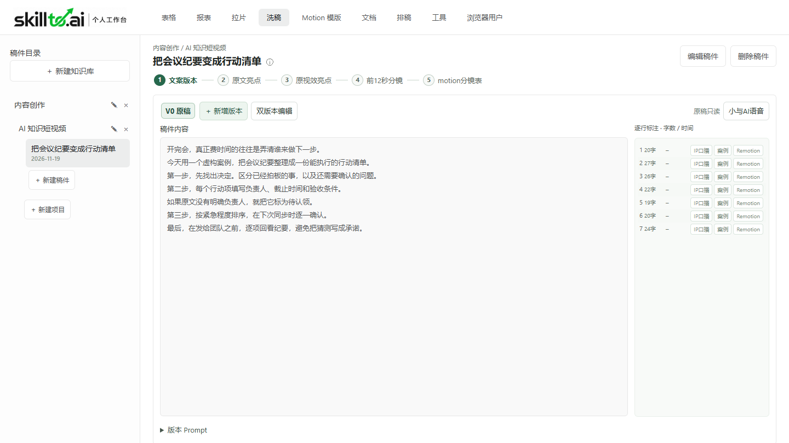
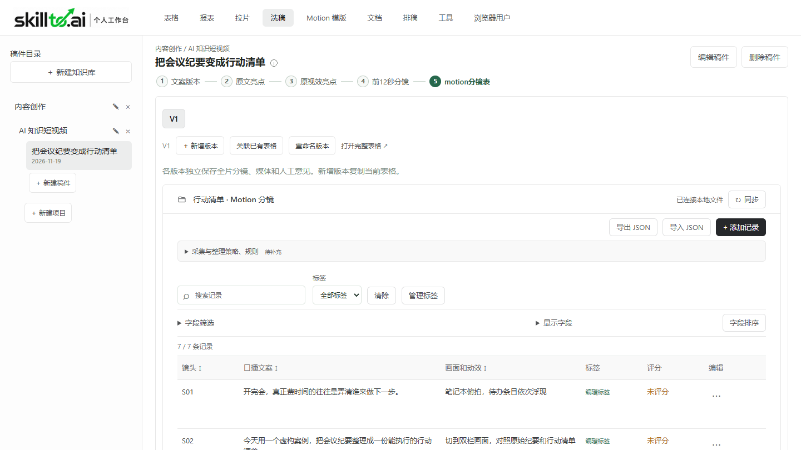

<p align="center">
  <picture>
    <source media="(prefers-color-scheme: dark)" srcset="docs/readme/assets/studio-logo-dark.png">
    
  </picture>
</p>

<h1 align="center">Skillto.ai Studio</h1>

<p align="center">The AI-native personal workspace built for agents</p>

<p align="center"><a href="#overview">Overview</a> · <a href="#architecture">Architecture</a> · <a href="#features">Features</a> · <a href="#screenshots">Screenshots</a> · <a href="#quick-start">Quick start</a> · <a href="skills/skillto-ai-studio/references/installation.md">Documentation</a><br>
  <a href="https://www.skillto.ai/">Skillto.ai</a> ·
  <a href="https://github.com/skilltoAI/skillto-ai-studio">GitHub</a> ·
  <a href="skills/skillto-ai-studio/SKILL.md"><kbd>19 Skills</kbd></a> ·
  <a href="apps/stass/README.md"><kbd>STASS MCP</kbd></a>
</p>

<p align="center"><a href="README.zh-CN.md"><kbd>简体中文</kbd></a> &nbsp; <kbd>English</kbd> &nbsp; <a href="README.ja.md"><kbd>日本語</kbd></a> &nbsp; <a href="README.de.md"><kbd>Deutsch</kbd></a></p>

## Overview

**Skillto.ai Studio is an AI-native personal workspace.** Describe what you want to achieve, and your agent selects the right Skills, works with your records through MCP, and leaves results you can review in knowledge bases, tables, scripts and storyboards. You can step in to edit the work, review it or decide what happens next.

Studio connects to the official Skillto.ai ecosystem. Bring available **AI assets, AI APIs and Skills** from the website into your workflow once the relevant services are connected and authorised. Keep the materials, decisions and deliverables for research, generation, editing and review together in one project. [Visit Skillto.ai](https://www.skillto.ai/)

## Architecture



Agents use Skills to choose a workflow and Personal MCP to act on the local workspace. The Personal Server stores project data. Authorised clients connect to Skillto.ai for cloud assets and generation.

## Who it is for

- **AI educators and paid-content creators** can research topics, break down reference videos, write teaching scripts, and review covers and storyboards.
- **Everyday AI users** can organise research, documents and tasks in knowledge bases, tables and reports, with space for human review notes.
- **AI creators** can manage characters, visual references, shots and motion templates while coordinating image generation, video generation and editing.

## Features

- **Skill orchestration.** One parent Skill routes tasks to 18 specialised Skills for research, media analysis, everyday work, storyboards, covers and reports.
- **A shared workspace for agents and people.** Supported agents read and update workspace records through STASS MCP. People can review and edit the same records in the browser.
- **AI-assisted editing and motion graphics.** Analyse reference clips, select segments and plan talking-head edits from rough cuts and subtitles with HyperFrames or Remotion. Organise templates and previews in Motion.
- **AI image and video generation.** Turn cover concepts, character references and shot plans into visual workflows. Creator MCP can bind assets, validate workflows, run authorised generation jobs and retrieve results. Available APIs, models and Skills depend on the website's offerings and your account permissions.

[Skill catalogue](#skill-catalogue) · [Host compatibility and dependencies](skills/skillto-ai-studio/references/compatibility.md)

## Screenshots

Captured from a running STASS instance with fictional demo data.

**Motion template gallery with cover previews**



**Multimedia table with image thumbnails**


**Content planning table and review notes**



**Script versions and line annotations**



**Linked Motion storyboard in the script workspace**



## Quick start

Install Git, Python 3.10+ and your target client. Run these commands to preview and install the skills:

```sh
git clone https://github.com/skilltoAI/skillto-ai-studio.git
cd skillto-ai-studio
python scripts/install.py --list
python scripts/install.py --agent codex --dry-run
python scripts/install.py --agent codex
```

For Claude Code, use `--agent claude` in place of `--agent codex`. Restart the session and invoke `$skillto-ai-studio` in Codex or `/skillto-ai-studio` in Claude Code.

### Claude Code marketplace

Use this option in place of direct skill installation:

```sh
claude plugin marketplace add https://github.com/skilltoAI/skillto-ai-studio.git
claude plugin install skillto-ai-studio@skillto-ai-studio-marketplace
claude plugin list
```

Open a new session and invoke `/skillto-ai-studio:skillto-ai-studio`. See the [installation guide](skills/skillto-ai-studio/references/installation.md) for client-specific paths, upgrades, rollback and troubleshooting.

## Windows workspace

The standalone STASS application and its MCP connections have separate setup steps. [GitHub Releases](https://github.com/skilltoAI/skillto-ai-studio/releases) currently has no Windows installer. To try the Windows x64 offline candidate, start from this GitHub branch:

```powershell
git clone --branch codex/stass-migration --single-branch https://github.com/skilltoAI/skillto-ai-studio.git
cd skillto-ai-studio
```

Follow the [offline build guide](apps/stass/README.md#构建离线-windows-x64-候选包) to build a package with the EXE, embedded Python, frontend and 19 skills. From the built package directory, run the installer with the build's SHA-256 digest for `release.json`:

```powershell
.\Install.ps1 -ManifestSha256 $manifestSha256
```

The default install location is `%LOCALAPPDATA%\Skillto.ai\Studio`. To test with an isolated instance, supply `-Root <new-directory> -Port <free-port>`. Host MCP registration, full installation and upgrade on another Windows machine, cross-machine data migration, and full rollback still require validation. [Windows installation audit](docs/WINDOWS-INSTALL-AUDIT.md)

## Skill catalogue

| Skill | What it does | Setup |
| --- | --- | --- |
| [skillto-ai-studio](skills/skillto-ai-studio/SKILL.md) | Parent entry point for task routing | [Guide](skills/skillto-ai-studio/references/installation.md) |
| [skillto-ai-studio-douyin-xhs-crawler](skills/skillto-ai-studio-douyin-xhs-crawler/SKILL.md) | Authorised Douyin and Xiaohongshu collection, account verification and recent metrics | [Guide](skills/skillto-ai-studio/references/child-setup.md#skillto-ai-studio-douyin-xhs-crawler) |
| [skillto-ai-studio-tiktok-crawler](skills/skillto-ai-studio-tiktok-crawler/SKILL.md) | Authorised TikTok collection, multilingual search and trend analysis | [Guide](skills/skillto-ai-studio/references/child-setup.md#skillto-ai-studio-tiktok-crawler) |
| [skillto-ai-studio-workbench](skills/skillto-ai-studio-workbench/SKILL.md) | Browser extension, clip selection and export, playback and notes | [Guide](skills/skillto-ai-studio/references/child-setup.md#skillto-ai-studio-workbench) |
| [skillto-ai-studio-table](skills/skillto-ai-studio-table/SKILL.md) | Multimedia tables, human review and semantic MCP tools | [Guide](skills/skillto-ai-studio/references/child-setup.md#skillto-ai-studio-table) |
| [skillto-ai-studio-reports](skills/skillto-ai-studio-reports/SKILL.md) | Local Metabase reports, charts, archiving and restore | [Guide](skills/skillto-ai-studio/references/child-setup.md#skillto-ai-studio-reports) |
| [skillto-ai-studio-style-library](skills/skillto-ai-studio-style-library/SKILL.md) | Visual style research and element-level motion planning | [Guide](skills/skillto-ai-studio/references/child-setup.md#skillto-ai-studio-style-library) |
| [skillto-ai-studio-motion](skills/skillto-ai-studio-motion/SKILL.md) | Motion template catalogue, inspection, tags, ratings and supported renders | [Guide](skills/skillto-ai-studio/references/child-setup.md#skillto-ai-studio-motion) |
| [skillto-ai-studio-rewrite](skills/skillto-ai-studio-rewrite/SKILL.md) | Source research, transcripts, script versions and human review | [Guide](skills/skillto-ai-studio/references/child-setup.md#skillto-ai-studio-rewrite) |
| [skillto-ai-studio-qwen38-media-analysis](skills/skillto-ai-studio-qwen38-media-analysis/SKILL.md) | Qwen3.8 media analysis, OCR, keyframes and shots | [Guide](skills/skillto-ai-studio/references/child-setup.md#skillto-ai-studio-qwen38-media-analysis) |
| [skillto-ai-studio-talking-head-edit](skills/skillto-ai-studio-talking-head-edit/SKILL.md) | HyperFrames planning and Remotion editing from rough cuts and timed subtitles | [Guide](skills/skillto-ai-studio/references/child-setup.md#skillto-ai-studio-talking-head-edit) |
| [skillto-ai-studio-explainer-storyboard](skills/skillto-ai-studio-explainer-storyboard/SKILL.md) | Evidence, beats, visual planning and storyboards for explainers | [Guide](skills/skillto-ai-studio/references/child-setup.md#skillto-ai-studio-explainer-storyboard) |
| [skillto-ai-studio-xiaoyu-cover](skills/skillto-ai-studio-xiaoyu-cover/SKILL.md) | Branded Xiaoyu covers for videos, tutorials and courses | [Guide](skills/skillto-ai-studio/references/child-setup.md#skillto-ai-studio-xiaoyu-cover) |
| [skillto-ai-studio-workflow-mcp](skills/skillto-ai-studio-workflow-mcp/SKILL.md) | Visual workflow editing, asset binding and execution via Creator MCP | [Guide](skills/skillto-ai-studio/references/child-setup.md#skillto-ai-studio-workflow-mcp) |
| [skillto-ai-studio-character-card](skills/skillto-ai-studio-character-card/SKILL.md) | Prompts and reference checks for character portraits and multi-view sheets | [Guide](skills/skillto-ai-studio/references/child-setup.md#skillto-ai-studio-character-card) |
| [skillto-ai-studio-depth-gray-replica](skills/skillto-ai-studio-depth-gray-replica/SKILL.md) | Authorised source collection, cut verification and timed breakdown | [Guide](skills/skillto-ai-studio/references/child-setup.md#skillto-ai-studio-depth-gray-replica) |
| [skillto-ai-studio-depth-gray-workflow](skills/skillto-ai-studio-depth-gray-workflow/SKILL.md) | Depth video, audio, shot references and editable SaaS workflows | [Guide](skills/skillto-ai-studio/references/child-setup.md#skillto-ai-studio-depth-gray-workflow) |
| [skillto-ai-studio-h3-workflow](skills/skillto-ai-studio-h3-workflow/SKILL.md) | Source-driven H3 character workflows with costume and prop references | [Guide](skills/skillto-ai-studio/references/child-setup.md#skillto-ai-studio-h3-workflow) |
| [skillto-ai-studio-ip-store](skills/skillto-ai-studio-ip-store/SKILL.md) | Character, setting and reference libraries across videos | [Guide](skills/skillto-ai-studio/references/child-setup.md#skillto-ai-studio-ip-store) |

## Contributing

```sh
python scripts/validate_repo.py
python -m unittest discover -s tests -v
git diff --check
```

See the [contribution and publishing rules](CONTRIBUTING.md), [technical standards](技术规范.md) and [distribution notes](docs/DISTRIBUTION.md). The repository has no project-wide open-source licence. Third-party components and brand assets remain subject to their own terms.
