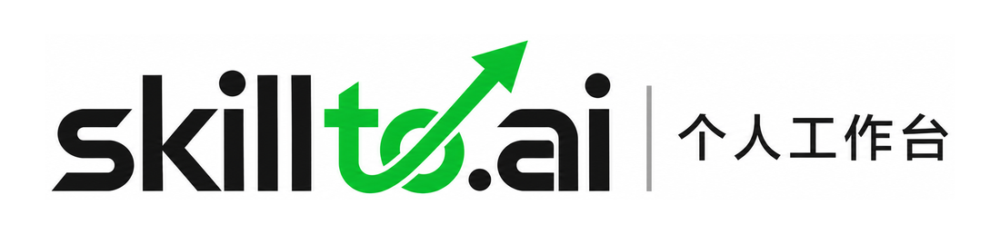
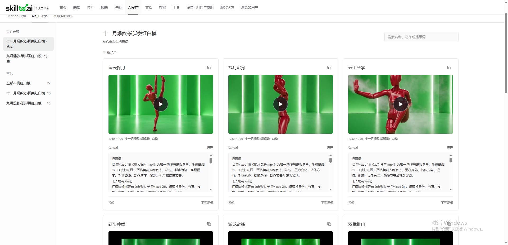
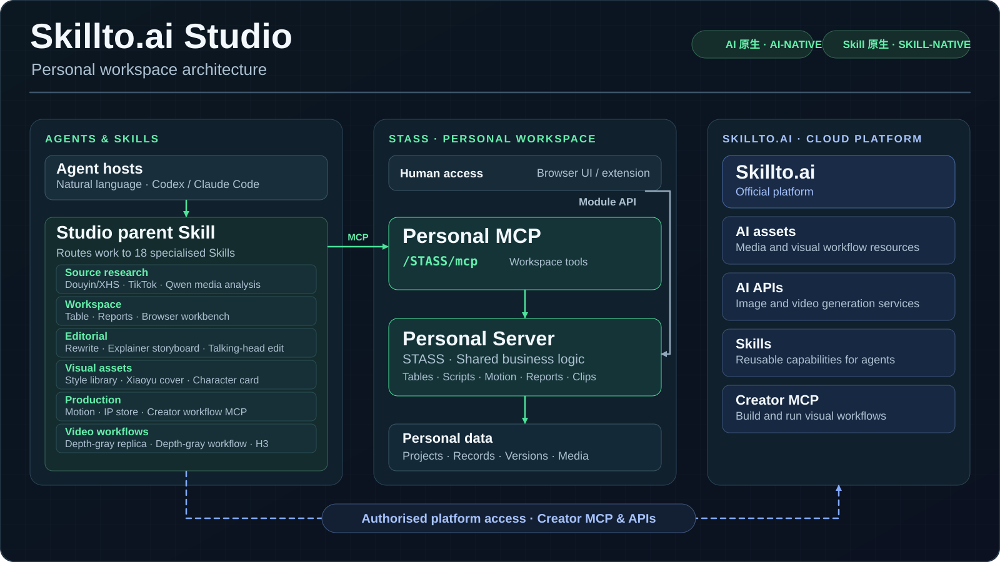
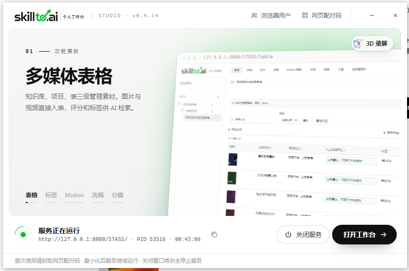
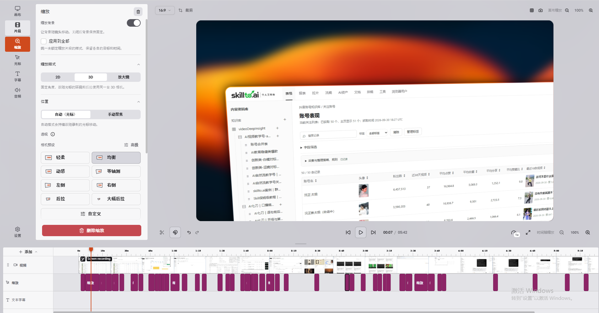
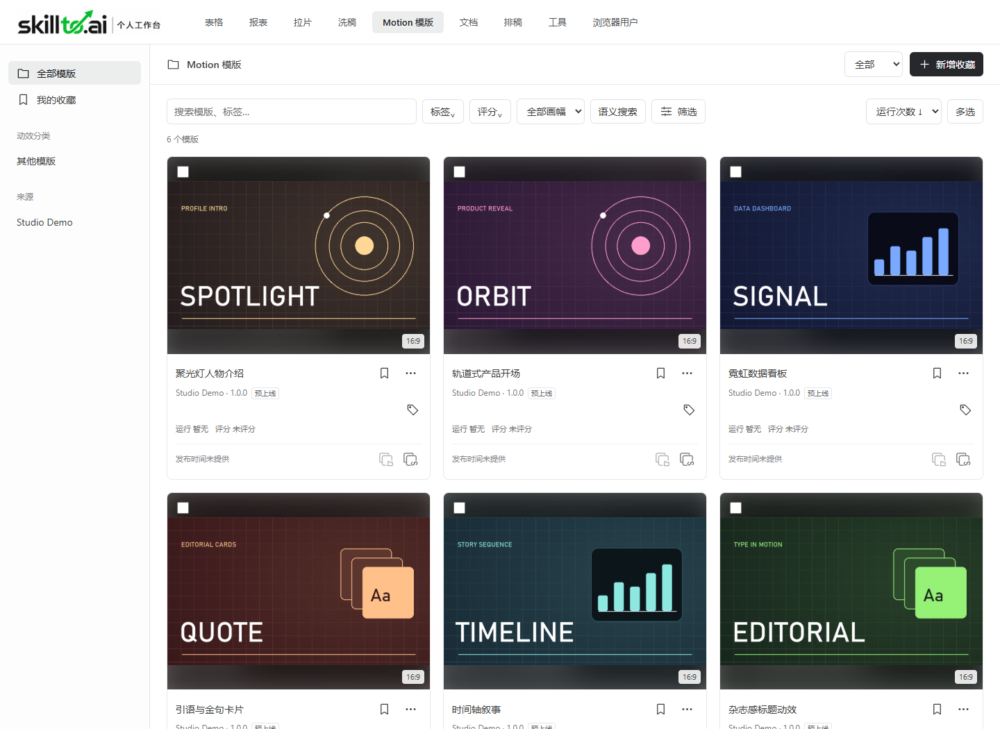
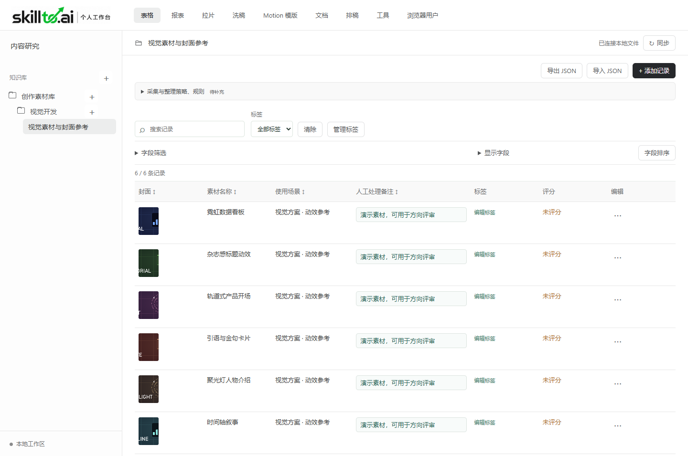
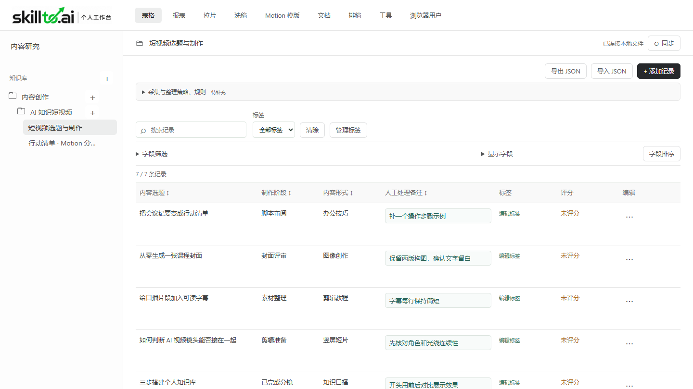
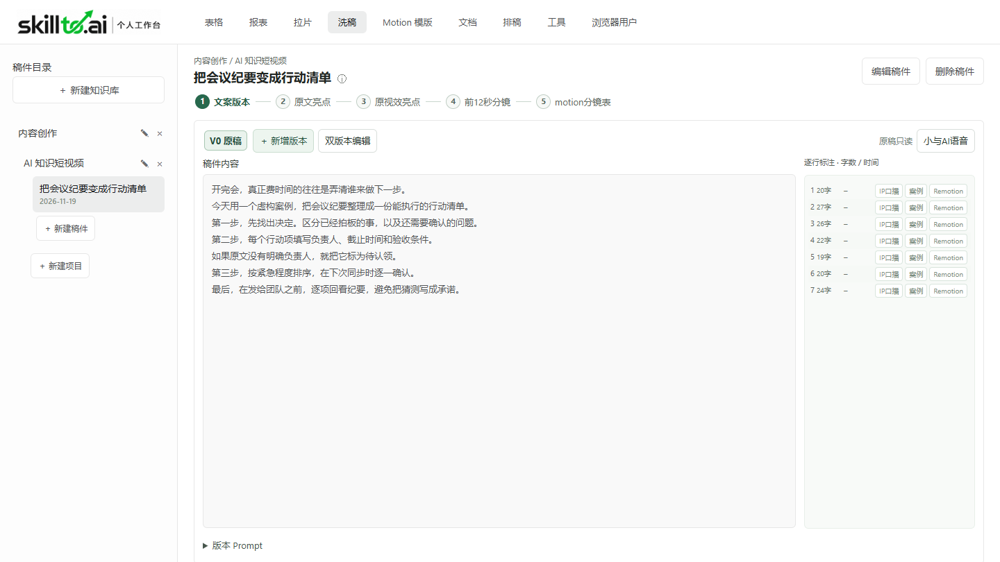
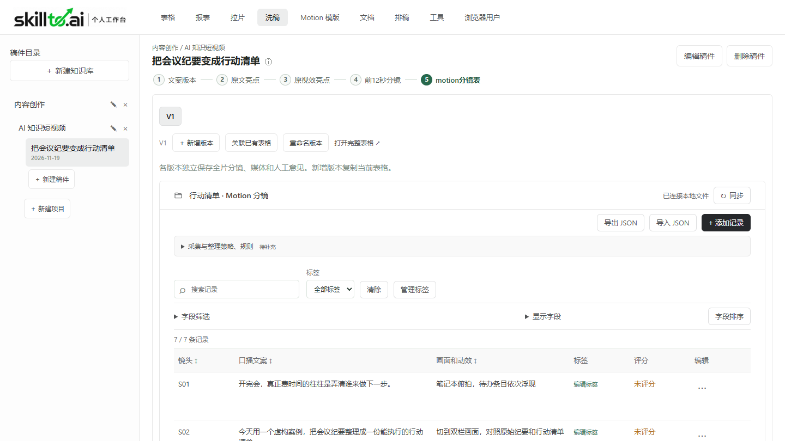

<p align="center">
  <picture>
    <source media="(prefers-color-scheme: dark)" srcset="docs/readme/assets/studio-logo-dark.png">
    
  </picture>
</p>

<h1 align="center">Skillto.ai Studio</h1>

<p align="center">为 Agent 而建的 AI Native 个人工作台</p>

<p align="center"><a href="#项目介绍">项目介绍</a> · <a href="#系统架构">架构</a> · <a href="#核心功能">功能</a> · <a href="#系统截图">系统截图</a> · <a href="#快速安装">快速安装</a> · <a href="skills/skillto-ai-studio/references/installation.md">文档</a><br>
  <a href="https://www.skillto.ai/">Skillto.ai</a> ·
  <a href="https://github.com/skilltoAI/skillto-ai-studio">GitHub</a> ·
  <a href="skills/skillto-ai-studio/SKILL.md"><kbd>20 Skills</kbd></a> ·
  <a href="apps/stass/README.md"><kbd>STASS MCP</kbd></a>
</p>

<p align="center"><kbd>简体中文</kbd> &nbsp; <a href="README.md"><kbd>English</kbd></a> &nbsp; <a href="README.ja.md"><kbd>日本語</kbd></a> &nbsp; <a href="README.de.md"><kbd>Deutsch</kbd></a></p>

## 复制安装提示词

复制下方整段到 Codex 或 Claude Code。GitHub 代码块右上角可一键复制。

```text
请从 https://github.com/skilltoAI/skillto-ai-studio 为当前客户端安装技能。先读取当前版本 apps/stass/work_catalog.json，只问一次“你日常需要处理哪些工作？（可多选）”，展示五类工作的名称和摘要。支持回复编号或类别名称，已经指定类别就直接采用。按用户选择执行 python scripts/install.py --agent 当前宿主 --groups "类别ID列表"，无需再次确认类别。完成后列出待配置项并给一个示例任务。
```

手动安装可运行 `python scripts/install.py --agent codex --groups`，输入如 `2、5`。Claude Code 改用 `--agent claude`。已有选择可用 `--augment --groups edit` 增补，`--dry-run` 只预览。显式 `--skill all` 安装完整技能集。启动器或 Web 设置中的 **安装新组件与技能** 可调整工作偏好、重新检测并复制加装提示词。WorkBody 支持提示词交接，安装接口待宿主验证。

## 项目介绍

Skillto.ai Studio 是一款 **AI Native 个人工作台**。你用自然语言描述目标，Agent 通过 Skill 选择工作流，通过 MCP 操作工作台，在知识库、表格、稿件和分镜里留下可查阅的结果。你可以在同一个工作台接手编辑、审阅和确认下一步。

工作台连接 Skillto.ai 官方生态。创作者可从官网获取可用的 **AI 资产、AI API 和 Skill**，并在完成服务接入和授权后，将它们用于本地工作流。从选题研究到分镜、生成、剪辑和审阅，素材、过程和成果可以沉淀到同一个项目。 [访问 Skillto.ai 官网](https://www.skillto.ai/)

## AI 美术资产

AI 红白模库把动作参考视频和配套提示词放在同一张卡片里。可以按官方专题或本机收藏浏览，预览动作并复制提示词，用于后续创作。下图展示工作台中的免费官方专题。



## 系统架构



AI 原生体现在 Agent 可以通过 MCP 直接执行工作台操作，Skill 原生体现在 1 个父 Skill 将任务路由给 19 个专业 Skill。Personal Server 保存本机数据，云端资产与生成能力通过 Skillto.ai 授权接入。

## 适合谁

| 人群 | 可以用它做什么 |
| --- | --- |
| **AI 知识付费博主** | 研究选题、拆解参考视频、写课程口播、做封面和分镜，并记录审稿意见。 |
| **日常 AI 办公用户** | 把文档、资料、数据和待办整理进知识库与项目，用表格、报表和人工备注跟进。 |
| **AI 创作者** | 管理角色、场景、分镜和 Motion 模板，把图片、视频生成和剪辑接进可复查的制作流程。 |

## 核心功能

- **Skill 编排**。1 个父 Skill 按目标路由到 19 个专业 Skill，覆盖采集、分析、办公、内容策划和视觉生产。 [完整技能清单](#技能清单)
- **Agent 与人共享工作台**。支持的 Agent 通过 STASS MCP 读取和更新工作记录，人可以在浏览器里审阅、编辑和补充人工意见。 [宿主兼容性与依赖](skills/skillto-ai-studio/references/compatibility.md)
- **AI 剪辑与动效**。从参考素材拆解、镜头选段到口播粗剪，根据字幕规划 HyperFrames 或 Remotion 编辑，并用 Motion 管理模板与预览。 [口播剪辑 Skill](skills/skillto-ai-studio-talking-head-edit/SKILL.md)
- **AI 生图与生视频**。把封面、角色卡和分镜转为可运行的视觉工作流，通过 Creator MCP 绑定素材、校验流程、调用已授权的生成服务并读取结果。具体 API、模型和 Skill 以官网可用范围及账户权限为准。 [视觉工作流 Skill](skills/skillto-ai-studio-workflow-mcp/SKILL.md)

## 系统截图

以下两张图来自集成 Beam 的 Windows 启动器版本。GitHub 默认分支尚未合入该版本，也未提供可下载的 Windows 安装包。

### 桌面工作台

Windows 启动器把个人服务状态、启停操作和功能一览集中在一个窗口。可以打开网页版工作台、管理浏览器用户、获取网页配对码，也可以直接进入 3D 录屏。网页版把多媒体表格、标签、Motion 模板、洗稿和分镜放在同一工作环境里。



### 3D 录屏与编辑

从启动器点击 **3D 录屏**，即可打开独立的 Beam 录屏编辑器，用于产品演示、课程录制和软件教程。录完后可在时间线上剪辑片段，添加 2D 缩放、3D 镜头或放大镜，选择跟随光标或手动聚焦，并调整透视预设、字幕和音频。STASS 服务停止时也可以打开录屏工具。



以下业务页面截图来自运行中的 STASS，使用隔离环境里的虚构示例。

**Motion 模板库 · 封面预览与模板条目**



**多媒体表格 · 图片缩略图与审阅备注**



**内容工作台 · 选题表与人工备注**



**稿件工作台 · 文案版本与逐行标注**



**Motion 分镜 · 在稿件内查看关联表格**



## Windows 完整安装状态

**当前未达到“在另一台 Windows 上完整安装 STASS 程序与全部技能”的交付门槛。**
技能复制安装器已存在；它不安装独立程序或自动注册新 STASS MCP。
从 [GitHub 源码分支](https://github.com/skilltoAI/skillto-ai-studio/tree/codex/stass-migration) 获取程序和技能源码。

```powershell
git clone --branch codex/stass-migration --single-branch https://github.com/skilltoAI/skillto-ai-studio.git
cd skillto-ai-studio
python scripts/install.py --list
```

随后按下面“快速安装”中的 Codex 或 Claude 命令安装技能，已有副本须先比较备份。
[GitHub Releases](https://github.com/skilltoAI/skillto-ai-studio/releases) 目前没有 Windows 安装包。需要离线安装时，按[程序构建指南](apps/stass/README.md#构建离线-windows-x64-候选包)从上述 GitHub 源码自行构建 **Windows x64 离线候选包**。候选包包含 EXE、嵌入式 Python、依赖、前端和 20 个技能。核对构建输出的清单摘要后，在包目录运行：

```powershell
.\Install.ps1 -ManifestSha256 $manifestSha256
```

`$manifestSha256` 为构建输出中 `release.json` 的 SHA-256。默认安装到 `%LOCALAPPDATA%\Skillto.ai\Studio`，命令返回实际 EXE 路径及服务地址。重复安装同一个包会复用已有实例。候选版应在隔离环境验证，隔离用法可加 `-Root <新目录> -Port <空闲端口>`。EXE 读取显式隔离配置时传入 `--config <新目录>/config/installation.json`。

各宿主的技能复制和 MCP 配置仍需独立验收。远程 npx 安装、跨主机数据迁移和完整升级回退仍需验收。构建与候选包验证见[程序开发说明](apps/stass/README.md)。

[Windows 安装审计及待补项目](docs/WINDOWS-INSTALL-AUDIT.md)列出了证据、已验证范围和阻塞项；
完整安装要求由[技术规范](技术规范.md)及[启动器与部署规范](docs/规范/启动器与部署规范.md)约束。

## 技能清单

| 技能 | 用途 | 安装与验收 |
| --- | --- | --- |
| [skillto-ai-studio](skills/skillto-ai-studio/SKILL.md) | 父入口，按任务路由到所需子技能 | [指引](skills/skillto-ai-studio/references/installation.md) |
| [skillto-ai-studio-douyin-xhs-crawler](skills/skillto-ai-studio-douyin-xhs-crawler/SKILL.md) | 获授权的抖音/小红书采集、账号验证与近期内容分析 | [指引](skills/skillto-ai-studio/references/child-setup.md#skillto-ai-studio-douyin-xhs-crawler) |
| [skillto-ai-studio-tiktok-crawler](skills/skillto-ai-studio-tiktok-crawler/SKILL.md) | TikTok 账号/关键词采集、多语言扩展、快照和热门分析 | [指引](skills/skillto-ai-studio/references/child-setup.md#skillto-ai-studio-tiktok-crawler) |
| [skillto-ai-studio-workbench](skills/skillto-ai-studio-workbench/SKILL.md) | 基于猫抓的工作台插件、双下载入口、视频选段预览导出、拉片播放与笔记 | [指引](skills/skillto-ai-studio/references/child-setup.md#skillto-ai-studio-workbench) |
| [skillto-ai-studio-table](skills/skillto-ai-studio-table/SKILL.md) | Skillto-AI-Studio · 表格工作台子技能；Skillto-AI-Studio 的多媒体表格、人工评审与语义 MCP CRUD | [指引](skills/skillto-ai-studio/references/child-setup.md#skillto-ai-studio-table) |
| [skillto-ai-studio-reports](skills/skillto-ai-studio-reports/SKILL.md) | 本地 Metabase 报表、图表及归档/恢复 | [指引](skills/skillto-ai-studio/references/child-setup.md#skillto-ai-studio-reports) |
| [skillto-ai-studio-style-library](skills/skillto-ai-studio-style-library/SKILL.md) | 14 类可拆解美术风格的场景检索、规范录入、元素独立动效与 Remotion/Motion 技术指南 | [指引](skills/skillto-ai-studio/references/child-setup.md#skillto-ai-studio-style-library) |
| [skillto-ai-studio-assets](skills/skillto-ai-studio-assets/SKILL.md) | AI资产分类、红白模原始提示词与在线播放、复制提示词及下载视频 | [Guide](skills/skillto-ai-studio/references/child-setup.md#skillto-ai-studio-assets) |
| [skillto-ai-studio-motion](skills/skillto-ai-studio-motion/SKILL.md) | Motion 模板库、.motion 工程检查、标签评分及已支持模板的实际预览与 MP4 制作 | [指引](skills/skillto-ai-studio/references/child-setup.md#skillto-ai-studio-motion) |
| [skillto-ai-studio-rewrite](skills/skillto-ai-studio-rewrite/SKILL.md) | 有来源证据的稿件研究、逐字稿、二创版本和人工评审 | [指引](skills/skillto-ai-studio/references/child-setup.md#skillto-ai-studio-rewrite) |
| [skillto-ai-studio-qwen38-media-analysis](skills/skillto-ai-studio-qwen38-media-analysis/SKILL.md) | 内网 Qwen3.8 图像理解、OCR、抽帧与分镜分析 | [指引](skills/skillto-ai-studio/references/child-setup.md#skillto-ai-studio-qwen38-media-analysis) |
| [skillto-ai-studio-talking-head-edit](skills/skillto-ai-studio-talking-head-edit/SKILL.md) | 粗剪口播与 SRT 的 HyperFrames 规划、Remotion 编辑及渲染 | [指引](skills/skillto-ai-studio/references/child-setup.md#skillto-ai-studio-talking-head-edit) |
| [skillto-ai-studio-explainer-storyboard](skills/skillto-ai-studio-explainer-storyboard/SKILL.md) | 知识、科普、新闻类短视频的证据清单、节拍图、视觉系统、分镜与审片 | [指引](skills/skillto-ai-studio/references/child-setup.md#skillto-ai-studio-explainer-storyboard) |
| [skillto-ai-studio-xiaoyu-cover](skills/skillto-ai-studio-xiaoyu-cover/SKILL.md) | 小与封面图，含品牌参考及独立构图的 3:4 / 4:3 PNG | [指引](skills/skillto-ai-studio/references/child-setup.md#skillto-ai-studio-xiaoyu-cover) |
| [skillto-ai-studio-workflow-mcp](skills/skillto-ai-studio-workflow-mcp/SKILL.md) | Creator MCP 工作流编辑、素材绑定、校验、运行与结果读取 | [指引](skills/skillto-ai-studio/references/child-setup.md#skillto-ai-studio-workflow-mcp) |
| [skillto-ai-studio-character-card](skills/skillto-ai-studio-character-card/SKILL.md) | 新角色定妆照/三视图提示词与直接引用核验 | [指引](skills/skillto-ai-studio/references/child-setup.md#skillto-ai-studio-character-card) |
| [skillto-ai-studio-depth-gray-replica](skills/skillto-ai-studio-depth-gray-replica/SKILL.md) | 原片采集、硬切核验和逐秒拆解；执行范围止于采集与分析 | [指引](skills/skillto-ai-studio/references/child-setup.md#skillto-ai-studio-depth-gray-replica) |
| [skillto-ai-studio-depth-gray-workflow](skills/skillto-ai-studio-depth-gray-workflow/SKILL.md) | 原片到本地深度视频、音频、分镜和 SaaS 替换工作流 | [指引](skills/skillto-ai-studio/references/child-setup.md#skillto-ai-studio-depth-gray-workflow) |
| [skillto-ai-studio-h3-workflow](skills/skillto-ai-studio-h3-workflow/SKILL.md) | 原片直驱 H3 角色替换工作流及服饰道具证据 | [指引](skills/skillto-ai-studio/references/child-setup.md#skillto-ai-studio-h3-workflow) |
| [skillto-ai-studio-ip-store](skills/skillto-ai-studio-ip-store/SKILL.md) | 角色卡、干净场景图及跨视频素材库 | [指引](skills/skillto-ai-studio/references/child-setup.md#skillto-ai-studio-ip-store) |

## 快速安装

Windows x64 首发提供单个工作台安装 EXE。macOS 目前使用下列 Skills 安装路径。安装资产、SHA-256、签名状态和测试范围见 [GitHub Releases](https://github.com/skilltoAI/skillto-ai-studio/releases)。

需要 Git、Python 3.10+ 和目标客户端。在终端运行（macOS/Linux 可用 `python3`）：

```sh
git clone https://github.com/skilltoAI/skillto-ai-studio.git
cd skillto-ai-studio
python scripts/install.py --list
python scripts/install.py --agent codex --groups
```

新 Codex 默认安装到 `~/.agents/skills`。已部署到旧 `$CODEX_HOME/skills` / `~/.codex/skills`
的用户显式加 `--codex-legacy`；安装器不自动迁移旧副本。Claude Code 改用：

```sh
python scripts/install.py --agent claude --groups
```

Windows 也可运行 `.\install.ps1 -Agent codex -ChooseWork`，macOS/Linux 可用
`sh install.sh --agent codex --groups`。按需安装传 `--skill <完整技能名>`；项目安装用
`--destination <project>/.agents/skills` 或 `<project>/.claude/skills`。
现有同名目录会阻止覆盖，升级前按安装指引备份并比较。安装器不自动安装业务依赖或配置 MCP。

新开会话后，Codex 调用 `$skillto-ai-studio`，Claude Code 直接安装调用 `/skillto-ai-studio`。

## Claude Code 安装完整插件

与直接复制方式二选一；通过本项目的 GitHub 地址注册：

```sh
claude plugin marketplace add https://github.com/skilltoAI/skillto-ai-studio.git
claude plugin install skillto-ai-studio@skillto-ai-studio-marketplace
claude plugin list
```

在新会话调用 `/skillto-ai-studio:skillto-ai-studio`，子技能如 `/skillto-ai-studio:skillto-ai-studio-table`。
离线注册、本地试用、升级和卸载见[统一安装指引](skills/skillto-ai-studio/references/installation.md)。

## 可用范围

技能文件安装与真实业务就绪分开验收。风格库、角色提示词和分镜规划可以离线使用；
表格 stdio MCP 只需 Python 标准库，另外注册到客户端。采集需要授权会话与浏览器；
SaaS 工作流需要 Creator MCP、自己的 Key 和对应权限。

独立 STASS 程序包含实际工作台网页。Windows 一体化分发、自动注册 MCP 和完整业务验收仍有缺项，见上面的安装状态。
Qwen 客户端依赖局域网部署，小与配音依赖外部 Windows 部署。封面与角色库指定的
`image_gen` 不由本仓库提供，普通 Claude Code 无法仅靠此插件获得它。
各项准备、支持边界和验收条件均列在[子技能安装表](skills/skillto-ai-studio/references/child-setup.md)。
不能把整套安装成功描述成所有业务已经跨平台验证。

## 维护与验证

```text
skills/                  可安装父技能和全部子技能
scripts/install.py       跨平台安装器（自动发现技能）
scripts/validate_repo.py  结构、路由、文档覆盖、链接和分发检查
tests/                   安装行为测试
.claude-plugin/          Claude 插件和 marketplace 清单
install.ps1 / install.sh 平台入口
AGENTS.md / .claude/CLAUDE.md  仓库协作规则
CONTRIBUTING.md           验证与发布约定
```

```sh
python scripts/validate_repo.py
python -m unittest discover -s tests -v
git diff --check
claude plugin validate .claude-plugin/plugin.json
claude plugin validate .
```

维护约定见 [CONTRIBUTING.md](CONTRIBUTING.md)。运行数据、Cookie、API Key、浏览器档案、
数据库与维护者本机 EXE 不进入 Git 或技能分发；程序安装包应单独构建、验收后发布。安装不授予采集、远端写入、付费运行或发布权限。
当前未声明整个仓库的开源许可证，不推定 MIT 等授权；品牌资源和 Cat Catch 等外部项目
保留各自权利与许可约束。

本次验证范围与已知部署限制见 [分发与改名记录](docs/DISTRIBUTION.md)。
